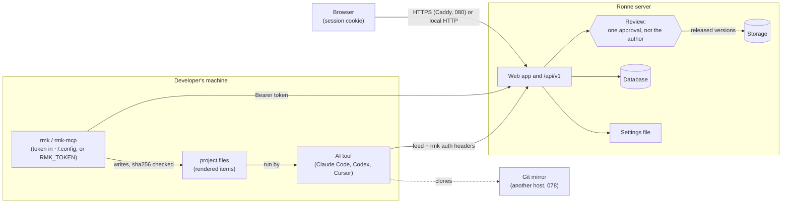

# Threat model

> Feature [098](../features/098-threat-model/SPEC.md) · Checked against the code on 2026-10-11 (commit
> `149e14a9`) · What to do when something goes wrong: the incident runbook,
> `docs/runbooks/incident-response.md` (coming in 098 task 5) · Reporting a vulnerability:
> [`SECURITY.md`](../../SECURITY.md)

This is what Ronne defends against, how, and what it leaves to the people who run it. Each "what
stops it" names the code that does it, so it can be checked; each gap names the feature that closes
it or the decision that accepts it. A feature that adds a trust boundary, a kind of token, a way to
upload or a kind of item updates this file in the same change, and the release checklist
([`release.md`](../runbooks/release.md)) checks it still matches (from 098 task 6).

## 1. What Ronne is, and what it holds

Ronne is a self-hosted registry of AI capabilities (skills, agents, rules, commands, hooks, MCP
servers and more). People write items in the web app or export them from their AI tools; a
moderator who isn't the author reviews them; released versions are installed into developers'
projects by `rmk`, by the registry MCP server, or through plugin feeds that Claude Code, Codex and
Cursor read. **Items are instructions and code that run on developers' machines with their
permissions**, so what Ronne guards most is the path from an author to everyone who installs.

What an instance holds:

| Asset | Where | Why it matters |
|---|---|---|
| Accounts: emails, names, password hashes (argon2), roles | database (`user`, `account`) | sign-in as anyone; personal data |
| Sessions | database (`session`), cookie signed with `AUTH_SECRET` | sign-in as their person |
| Access tokens | database (`access_tokens`), sha256 only | `rmk`, MCP and feeds as their user |
| Items: released versions | storage (`.tgz`, immutable) and database (sha256) | run on every machine that installs them |
| Drafts and submissions | database (`submission_files`) | not reviewed yet; may be private work |
| The audit log, with IP addresses | database (`audit_events`) | the record of who did what |
| Usage totals | database | aggregated, nothing about who sent them |
| The settings file | `.env` / `/etc/rmk-server/env` / `…\Marketplace\.env` | `DATABASE_URL` (with its password) and `AUTH_SECRET` |
| Backups (099) | wherever the operator keeps them | all of the above |

## 2. Who might attack it

| Who | Can do | Wants |
|---|---|---|
| **Someone on the network, no account** | reach the sign-in page, `/api/health`, `/api/v1` without a token | an account, a token, or to know what's inside |
| **A signed-in user** | read what their workspaces allow, write drafts, submit | items or workspaces they aren't allowed to see |
| **A malicious or careless author** | submit any item, in any scope they can write to | their code on other people's machines |
| **A moderator or workspace admin acting alone** | approve, release, yank in their workspaces | release something harmful without a second person |
| **A stolen access token or session** | everything its user can | the same, from elsewhere |
| **Someone who reads the server's disk, database or backups** | read everything at rest | secrets, sessions, private items |
| **A compromised dependency or image** | run inside our build or our server | the server, or every instance at once |
| **A compromised developer machine with an `rmk` token** | the token's user's access | the registry, through that token |

## 3. Trust boundaries

The boundaries, in order of what's at stake:

1. **Author → everyone who installs.** The review is the boundary (MVP §12).
2. **The network → the web app and the API.** Sessions for the browser, tokens for the rest.
3. **One workspace → another.** Private workspaces are invisible to non-members.
4. **The server → its disk, database, settings and backups.** Whoever runs the instance.
5. **The registry → developers' machines.** What `rmk` writes and what the AI tools then run.
6. **The registry → a git mirror** on a host Ronne doesn't control.
7. **Our build → every instance.** Dependencies, images, packages.

## 4. Threats

### 4.1 Author → everyone who installs (items run on developers' machines)

| Threat | What stops it today | What's left |
|---|---|---|
| An author releases harmful code or instructions | Outside personal workspaces (next row), nothing is released without review: draft → submitted → approved by a moderator or root who isn't the author (014; `OWN_SUBMISSION_REASON`, `apps/web/src/server/domains/submissions/services/decisions.ts:18`); root may approve their own submission as an override, with or without a reason (optional since 054, `apps/web/src/server/domains/submissions/services/reviews.ts:106`), always audited as `submission.override_approved` (`apps/web/src/server/domains/audit/models/audit-event.ts`) | A reviewer who approves something harmful. One approval is the rule (MVP §15). Root can approve alone, on the record |
| An owner releases unreviewed work from their personal workspace | A personal workspace (114) is private to its owner and root; its submissions are approved by the owner at once (`self_approve`, `apps/web/src/server/domains/submissions/services/submissions.ts:321`) and marked not reviewed; nobody else can install them; moving its scope to a shared workspace or `global` needs root or another admin of the target, who sees the not-reviewed versions and marks them reviewed (115) | The owner (and root) run what was never reviewed. Accepted: MVP §15, Approval |
| Risky content slips past a busy reviewer | Risk flags `hook`, `mcp_server`, `permission_policy`, `status_or_lsp`, `executable`, `shell_script`, `network` (`packages/core/src/risk-flags.ts:68`), shown on the review page, the queue, the item page and `rmk info`; they describe, never block, and authors can't hide them; bulk approve lists flagged items first (054) | Skills, commands and agents are text that can tell the AI to run commands; no flag catches every such instruction. Accepted: the reviewer reads them |
| A released version is changed afterwards | Versions are immutable; `rmk` checks sha256 on every download and against `rmk.lock`, and writes nothing on a mismatch (`checksum_mismatch`, `packages/cli/src/install.ts:141`) | Someone with write access to storage *and* the database can change both. No signatures: designed in MVP §14.2, post-MVP |
| Installing runs the item | `rmk install` only writes files inside managed target paths, never runs them (`packages/cli/src/apply.ts`); unmanaged and user-edited files are never overwritten | The AI tool runs hooks, MCP servers and status lines once written; that's what they're for. The review above is the guard |
| A harmful version stays installable after it's found | Yank (016): new installs can't resolve it, `latest` moves back (`latestAfterYank`), feeds drop it at their next refresh | A lockfile that pins it keeps installing it, **without the warning 022's spec promises** (`packages/core/src/resolve.ts` returns no warning for a yanked pin): known gap, below. Files already written stay until the project runs `rmk update`. The incident runbook (098 task 5) will cover it |
| An item carries a secret | MCP configs name environment variables, never values; export stops on known secret formats (`secretLike`, `packages/core/src/package-checks.ts:90`) | A secret in a format no pattern knows |
| Export uploads more than the person meant | `rmk export` and the MCP export tools upload only the files in the preview the person saw; never `.env` files, keys, `.git` or symbolic links, never an environment variable's value; over MCP only items in the tools' own folders (MVP §12; [native readers](../spec/native-readers.md) §3; `packages/cli/src/export-command.ts`) | A file the person approved without reading it |

### 4.2 The network → the web app and the API

| Threat | What stops it today | What's left |
|---|---|---|
| Guessing passwords | 5 attempts a minute per email and per IP (`apps/web/src/server/domains/identity/models/login-rate-limiter.ts:19`); the same limiter on `POST /api/v1/auth/token`; wrong password, unknown email and disabled user get the same answer (`identity/services/session.ts:45`) | The limits live in one process's memory and reset on restart (109). No second factor (105) |
| A stolen session cookie | Sessions are rows in the database, read on every request (`currentUser`, `identity/services/session.ts:26`), so Disable, Reset password, `rmk-server revoke-access` and `rmk-server rotate-secret` (098, `apps/web/src/server/domains/identity/services/instance-access.ts`) end them at the next request; no cookie cache is configured (`identity/repositories/better-auth.ts`) | A session lasts up to 30 days with "remember me". If a cookie cache is ever turned on, ending sessions must clear it |
| A stolen access token | Only sha256 is stored (`identity/models/access-token.ts:40`); `rmk_` prefix so secret scanners can match it (`:8`); 30, 90 or 365 days, or none (`:18`); at most 50 active per user; revoked by its owner, by Disable and Reset password (`identity/services/user-admin.ts:195`, `:259`), and in bulk by `rmk-server revoke-access` (098, `revokeAccess` in `identity/services/instance-access.ts`); a disabled user's tokens stop at once (`identity/services/access-tokens.ts:134`) | A token acts as its whole user, in every workspace (116). "No expiry" is allowed (009's choice; the owner sees it when choosing) |
| Forged session cookies | Cookies are signed with `AUTH_SECRET` (32 random bytes from setup, `setup/env-file.ts`) | Anyone who reads the settings file can sign cookies until the secret rotates: `rmk-server rotate-secret` writes a new one and ends every session (098, `apps/web/src/server/setup/rotate-secret.ts`), and a cookie signed with the old secret is refused once the server reads the new one (the next request with Docker and `rmk-server`, a restart for a clone) |
| Traffic read on the way | HTTPS through Caddy with a domain (080, 083, 086); HTTP/1.1 only while exception E-7 lasts (`compose.yaml`, `packages/server/src/service/caddyfile.ts`) | A local install (`localhost:7650`) is plain HTTP by design; on a network, use a domain (install guide) |
| Oversized or hostile uploads | Body limits (`proxy.ts`, 28 MiB for drafts), 5 MB packed / 20 MB unpacked / 500 files / 1 MB a file (`packages/core/src/limits.ts`), `..` and absolute paths refused (`packages/core/src/package-checks.ts:29-31`), links refused when unpacking (`packages/core/src/pack/tar.ts:107`, `apps/web/src/server/domains/submissions/models/zip.ts:124`), 30 uploads per 10 minutes and the upload API refuses a new draft once its author has 50 (037, `MAX_API_DRAFTS`; the web editor has no limit) | Upload rate limits are in memory too (109) |
| Usage reports used to flood or track | 60 per 10 minutes, 256 KiB, added to daily totals with nothing about the sender (046) | — |

### 4.3 One workspace → another (private workspaces)

| Threat | What stops it today | What's left |
|---|---|---|
| A non-member reads a private workspace's items, scopes or submissions | Every read takes the reader; non-members get the same "not found" as an unknown name everywhere: web app, search, API, tarballs, resolve, MCP, feeds, "Used by" (093); guard tests fail on a repository read that doesn't filter (`domains/items/repositories/visibility-guard.db.test.ts`, `domains/submissions/repositories/visibility-guard.db.test.ts`) | What private doesn't do (MVP §12): it isn't encryption; root sees every workspace; a name already in someone's lockfile stays there; the audit log (root only) names private items |
| A public item depends on a private one | Only a workspace's own items can depend on its items; turning a workspace private is refused while outside items depend on it (093) | — |
| Logs or telemetry leak private names | Planned: no item, scope or workspace names in logs (100) or telemetry (101) | Until 100 ships, the server logs almost nothing |

### 4.4 The server → its disk, database, settings and backups

| Threat | What stops it today | What's left |
|---|---|---|
| Someone reads the settings file | Written with mode 0600 through a temporary file (`writeEnvFile`, `apps/web/src/server/setup/env-file.ts`); `AUTH_SECRET` signs cookies and nothing else; tokens are hashes, passwords argon2 | With it, someone can sign in as anyone (forged cookies) and reach the database. The incident runbook (098 task 5): "The settings file, a backup or the server leaked" |
| Someone reads the database or storage | Token hashes and password hashes only | Everything else is in the clear unless the disk or the database encrypts it. Accepted (MVP §15, Operations: encryption at rest is the platform's); 099 documents how |
| Someone reads a backup | Planned: `backup --encrypt` (099) | Unencrypted backups hold the settings file |
| The audit log is altered | Append-only: a guard test fails on any update or delete outside migrations (`domains/audit/audit-log.guard.test.ts`) | Anyone with database write access can change it. No export to an outside store (post-MVP, 007) |
| Personal data kept forever | — | IP addresses and expired sessions are kept until 102 sets retention; erasing a person is 103 |
| Data lost with no way back | — | Planned: `rmk-server backup` and `restore` (099). Migrations run on start and can't go back |

### 4.5 The registry → developers' machines and git mirrors

| Threat | What stops it today | What's left |
|---|---|---|
| A token leaks through the AI tool's settings | By default Claude Code's feed asks `rmk auth headers` for the token at run time (`packages/cli/src/plugin-setup.ts:96`), so it's never in the URL or the settings file; from a project's settings Claude Code strips credential-looking variables first (`docs/spec/plugin-feeds.md`) | `rmk plugin-setup claude-code --static-headers` writes the token into the user's Claude Code settings (`plugin-setup.ts:95`), as its help says. The token on the machine is as safe as the machine |
| `rmk` writes outside the project | Renderers write only to known target paths, checked with `lstat` before writing (`packages/cli/src/apply.ts:62`) | — |
| A git mirror exposes private items | The mirror is built only with the items the building account sees, and only for chosen workspaces (`rmk feed build --workspace`, 078) | A mirror is as private as the repository it's pushed to (MVP §12), and its push token lives in that CI |

### 4.6 Our build → every instance (our supply chain)

| Threat | What stops it today | What's left |
|---|---|---|
| A malicious npm release | pnpm waits 3 days before installing a release (`minimumReleaseAge: 4320`), fails on lost publishing trust (`trustPolicy: no-downgrade`), runs install scripts only from an allowlist (`strictDepBuilds`, `allowBuilds`), and refuses git and tarball sub-dependencies (`blockExoticSubdeps`) (`pnpm-workspace.yaml`) | A malicious release that stays hidden past 3 days |
| Known vulnerabilities | `pnpm audit --audit-level high` and `pnpm licenses:check` in CI and nightly; CodeQL (`codeql.yml`); Trivy on the images (`.github/actions/build-image/action.yml`) | Time-limited exceptions such as E-7, Caddy's three Go CVEs until 2026-10-23 (`docs/policies/dependencies.md`) |
| A swapped base image | Base images pinned by digest (`Dockerfile`: `node:24-trixie-slim@sha256:…`; Caddy in `compose.yaml`) | The optional database images in `compose.yaml` (`postgres:18`, `mysql:8.4`, the `postgres` and `mysql` profiles) are pinned by tag only |
| A tampered package or image | npm trusted publishing with provenance; the image with BuildKit provenance and an SBOM (`.github/workflows/release.yml`) | The bundles, `.deb` and `.rpm` have checksums but no signatures; the Windows installer is unsigned until SignPath signs it (087) |

## 5. Known gaps

Checked on 2026-10-11.

| Gap | Closed by, or accepted by |
|---|---|
| A token reaches all of its user's workspaces | 116, per-workspace tokens (planned) |
| No second factor at sign-in | 105, two-factor sign-in (planned, M16) |
| Rate limits in one process's memory, reset on restart | 109, shared rate limits (planned, M17) |
| No release signatures | MVP §14.2 (designed, post-MVP) |
| No backups or restore | 099 (M14) |
| No structured logs, no request IDs | 100 (M14) |
| No monitoring beyond `/api/health` | 101 (M14) |
| IP addresses and expired sessions kept indefinitely | 102, retention (planned, M15) |
| A person can't be erased | 103 (planned, M15) |
| Data at rest not encrypted by Ronne | Accepted: MVP §15, Operations (the disk's, the database's, the bucket's) |
| Skills, commands and agents can carry harmful instructions no flag finds | Accepted: MVP §12, review is the boundary |
| Tokens may have no expiry | Accepted: 009 (the person chooses it) |
| Audit log can't be exported to an outside store | Accepted for now: 007 (post-MVP) |
| Server packages and bundles unsigned; Windows installer unsigned | 087 (SignPath); MVP §14.2 |
| A git mirror's privacy is its repository's | Accepted: MVP §12 |
| `rmk` installs a yanked version a lockfile pins without the warning 022's spec promises | Not planned yet: a bug against 022, for the owner to file and schedule |
| The optional PostgreSQL and MySQL images are pinned by tag, not digest | Not planned yet: for the owner (the dependency policy pins images by digest) |
| Personal workspaces release without review | Accepted: MVP §15, Approval (114, 115) |

## 6. Keeping it true

- A feature that adds a trust boundary, a token kind, an upload path, an item type or a feed
  updates this file in the same change, as it updates the Documentation.
- The release checklist ([`release.md`](../runbooks/release.md)) asks whether it still matches
  (the step comes in 098 task 6).
- The date and commit at the top change when it's checked again.
