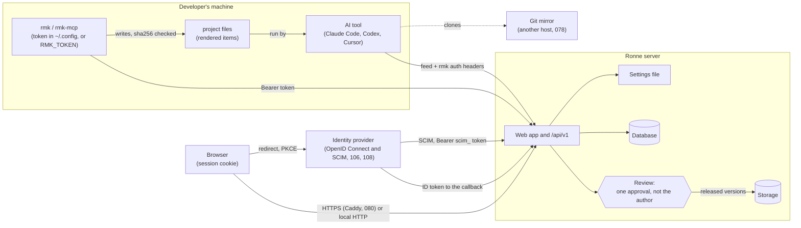

# Threat model

> Feature [098](../features/098-threat-model/SPEC.md) · Checked against the code on 2026-10-20 (commit
> `85c593e5`, before 0.5.0) · What to do when something goes wrong: the
> [incident runbook](../runbooks/incident-response.md) · Reporting a vulnerability:
> [`SECURITY.md`](../../SECURITY.md)

This is what Ronne defends against, how, and what it leaves to the people who run it. Each "what
stops it" names the code that does it, so it can be checked; each gap names the feature that closes
it or the decision that accepts it. A feature that adds a trust boundary, a kind of token, a way to
upload or a kind of item updates this file in the same change, and the release checklist
([`release.md`](../runbooks/release.md)) checks it still matches.

## 1. What Ronne is, and what it holds

Ronne is a self-hosted registry of AI capabilities (skills, agents, rules, commands, hooks, MCP
servers and more). People write items in the web app or export them from their AI tools; a
moderator who isn't the author reviews them; released versions are installed into developers'
projects by `rmk`, by the registry MCP server, or through plugin feeds that Claude Code, Codex and
Cursor read. **Items are instructions and code that run on developers' machines with their
permissions**, so what Ronne guards most is the path from an author to everyone who installs.

What an instance holds:

| Asset | Where | Why it matters |
|---|---|---|
| Accounts: emails, names, password hashes (argon2), roles | database (`user`, `account`) | sign-in as anyone; personal data |
| Sessions | database (`session`), cookie signed with `AUTH_SECRET` | sign-in as their person |
| Access tokens, including the ones `rmk login --web` makes (107) | database (`access_tokens`), sha256 only | `rmk`, MCP and feeds as their user |
| Two-factor secrets and backup codes (105) | database (`two_factor`), encrypted with a key from `AUTH_SECRET` | the second step of sign-in |
| Identity providers' client secrets (106) | database (`identity_providers.secret_enc`), AES-256-GCM with a key from `AUTH_SECRET` | sign-in through the company's provider |
| SCIM tokens (108) | database, sha256 only | create, change and disable accounts and group memberships |
| Items: released versions | storage (`.tgz`, immutable) and database (sha256) | run on every machine that installs them |
| Drafts and submissions | database (`submission_files`) | not reviewed yet; may be private work |
| The audit log, with IP addresses | database (`audit_log`) | the record of who did what; the addresses are cleared after the retention (102) |
| Usage totals | database | aggregated, nothing about who sent them |
| The settings file | `.env` / `/etc/rmk-server/env` / `…\Marketplace\.env` | `DATABASE_URL` (with its password) and `AUTH_SECRET` |
| Backups (099) | wherever the operator keeps them | all of the above |

## 2. Who might attack it

| Who | Can do | Wants |
|---|---|---|
| **Someone on the network, no account** | reach the sign-in page, `/api/health`, `/api/v1` without a token | an account, a token, or to know what's inside |
| **A signed-in user** | read what their workspaces allow, write drafts, submit | items or workspaces they aren't allowed to see |
| **A malicious or careless author** | submit any item, in any scope they can write to | their code on other people's machines |
| **A moderator or workspace admin acting alone** | approve, release, yank in their workspaces | release something harmful without a second person |
| **Someone who has a person's password, not their phone** | sign in with the first step | an account, past a leaked or guessed password |
| **A company's identity provider, or whoever administers it (106, 108)** | sign people in as anyone in the domains root chose, and, through groups and SCIM, put them in workspace roles and disable accounts | accounts, and the right to approve |
| **A stolen access token or session** | everything its user can | the same, from elsewhere |
| **Someone who reads the server's disk, database or backups** | read everything at rest | secrets, sessions, private items |
| **A compromised dependency or image** | run inside our build or our server | the server, or every instance at once |
| **A compromised developer machine with an `rmk` token** | the token's user's access | the registry, through that token |

## 3. Trust boundaries

The boundaries, in order of what's at stake:

1. **Author → everyone who installs.** The review is the boundary (MVP §12).
2. **The network → the web app and the API.** Sessions for the browser, tokens for the rest.
3. **One workspace → another.** Private workspaces are invisible to non-members.
4. **The server → its disk, database, settings and backups.** Whoever runs the instance.
5. **The registry → developers' machines.** What `rmk` writes and what the AI tools then run.
6. **The registry → a git mirror** on a host Ronne doesn't control.
7. **Our build → every instance.** Dependencies, images, packages.
8. **A company's identity provider → accounts and roles** (106, 108). What the provider says is believed in the domains root chose.

## 4. Threats

### 4.1 Author → everyone who installs (items run on developers' machines)

| Threat | What stops it today | What's left |
|---|---|---|
| An author releases harmful code or instructions | Outside personal workspaces (next row), nothing is released without review: draft → submitted → approved by a moderator or root who isn't the author (014; `OWN_SUBMISSION_REASON`, `apps/web/src/server/domains/submissions/services/decisions.ts:18`); root may approve their own submission as an override, with or without a reason (optional since 054, `apps/web/src/server/domains/submissions/services/reviews.ts:106`), always audited as `submission.override_approved` (`apps/web/src/server/domains/audit/models/audit-event.ts`) | A reviewer who approves something harmful. One approval is the rule (MVP §15). Root can approve alone, on the record |
| An owner releases unreviewed work from their personal workspace | A personal workspace (114) is private to its owner and root; its submissions are approved by the owner at once (`self_approve`, `apps/web/src/server/domains/submissions/services/submissions.ts:321`) and marked not reviewed; nobody else can install them; moving its scope to a shared workspace or `global` needs root or another admin of the target, who sees the not-reviewed versions and marks them reviewed (115) | The owner (and root) run what was never reviewed. Accepted: MVP §15, Approval |
| Risky content slips past a busy reviewer | Risk flags `hook`, `mcp_server`, `permission_policy`, `status_or_lsp`, `executable`, `shell_script`, `network` (`packages/core/src/risk-flags.ts:68`), shown on the review page, the queue, the item page and `rmk info`; they describe, never block, and authors can't hide them; bulk approve lists flagged items first (054) | Skills, commands and agents are text that can tell the AI to run commands; no flag catches every such instruction. Accepted: the reviewer reads them |
| A released version is changed afterwards | Versions are immutable; `rmk` checks sha256 on every download and against `rmk.lock`, and writes nothing on a mismatch (`checksum_mismatch`, `packages/cli/src/install.ts:141`) | Someone with write access to storage *and* the database can change both. No signatures: designed in MVP §14.2, post-MVP |
| Installing runs the item | `rmk install` only writes files inside managed target paths, never runs them (`packages/cli/src/apply.ts`); unmanaged and user-edited files are never overwritten | The AI tool runs hooks, MCP servers and status lines once written; that's what they're for. The review above is the guard |
| A harmful version stays installable after it's found | Yank (016): new installs can't resolve it, `latest` moves back (`latestAfterYank`), feeds drop it at their next refresh | A project that asks for a range keeps installing the version its lockfile pins, **without the warning 022's spec promises** (`packages/core/src/resolve.ts` returns no warning for a yanked pin), and its files, until `rmk update`; one that asks for a tag such as `latest` follows the tag at its next `rmk install`, so the lockfile doesn't hold it as 022 says: known gaps, below. The [incident runbook](../runbooks/incident-response.md) covers it |
| An item carries a secret | MCP configs name environment variables, never values; export stops on known secret formats (`secretLike`, `packages/core/src/package-checks.ts:90`) | A secret in a format no pattern knows |
| Export uploads more than the person meant | `rmk export` and the MCP export tools upload only the files in the preview the person saw; never `.env` files, keys, `.git` or symbolic links, never an environment variable's value; over MCP only items in the tools' own folders (MVP §12; [native readers](../spec/native-readers.md) §3; `packages/cli/src/export-command.ts`) | A file the person approved without reading it |

### 4.2 The network → the web app and the API

| Threat | What stops it today | What's left |
|---|---|---|
| Guessing passwords | 5 attempts a minute per email and per IP (`apps/web/src/server/domains/identity/models/login-rate-limiter.ts:19`); the same limiter on `POST /api/v1/auth/token`; wrong password, unknown email and disabled user get the same answer (`identity/services/session.ts:45`) | The limits live in one process's memory and reset on restart (109). A person adds a second step themselves; root may require it (next row) |
| A stolen session cookie | Sessions are rows in the database, read on every request (`currentUser`, `identity/services/session.ts:26`), so Disable, Reset password, `rmk-server revoke-access` and `rmk-server rotate-secret` (098, `apps/web/src/server/domains/identity/services/instance-access.ts`) end them at the next request; no cookie cache is configured (`identity/repositories/better-auth.ts`) | A session lasts up to 30 days with "remember me". If a cookie cache is ever turned on, ending sessions must clear it |
| A stolen access token | Only sha256 is stored (`identity/models/access-token.ts:40`); `rmk_` prefix so secret scanners can match it (`:8`); 30, 90 or 365 days, or none (`:18`); at most 50 active per user; revoked by its owner, by Disable and Reset password (`identity/services/user-admin.ts:195`, `:259`), and in bulk by `rmk-server revoke-access` (098, `revokeAccess` in `identity/services/instance-access.ts`); a disabled user's tokens stop at once (`identity/services/access-tokens.ts:134`) | A token acts as its whole user, in every workspace (116). "No expiry" is allowed (009's choice; the owner sees it when choosing) |
| Forged session cookies | Cookies are signed with `AUTH_SECRET` (32 random bytes from setup, `setup/env-file.ts`) | Anyone who reads the settings file can sign cookies until the secret rotates: `rmk-server rotate-secret` writes a new one and ends every session (098, `apps/web/src/server/setup/rotate-secret.ts`), and a cookie signed with the old secret is refused once the server reads the new one (the next request with Docker and `rmk-server`, a restart for a clone) |
| Traffic read on the way | HTTPS through Caddy with a domain (080, 083, 086); HTTP/1.1 only while exception E-7 lasts (`compose.yaml`, `packages/server/src/service/caddyfile.ts`) | A local install (`localhost:7650`) is plain HTTP by design; on a network, use a domain (install guide) |
| Oversized or hostile uploads | Body limits (`proxy.ts`, 28 MiB for drafts), 5 MB packed / 20 MB unpacked / 500 files / 1 MB a file (`packages/core/src/limits.ts`), `..` and absolute paths refused (`packages/core/src/package-checks.ts:29-31`), links refused when unpacking (`packages/core/src/pack/tar.ts:107`, `apps/web/src/server/domains/submissions/models/zip.ts:124`), 30 uploads per 10 minutes and the upload API refuses a new draft once its author has 50 (037, `MAX_API_DRAFTS`; the web editor has no limit) | Upload rate limits are in memory too (109) |
| Usage reports used to flood or track | 60 per 10 minutes, 256 KiB, added to daily totals with nothing about the sender (046) | — |

| A password that leaks or is guessed is enough to sign in | Two-factor sign-in (105): a code from an authenticator app (TOTP) after the password, with backup codes; root makes it optional, required for everyone, or required for roots and moderators. One sign-in challenge takes at most 5 codes, 10 wrong codes in a row lock the second step for 15 minutes; a person who must enrol is held on `/account/security` and every server action refuses until they have; the TOTP secret and backup codes are encrypted with a key from `AUTH_SECRET`, and `rmk-server rotate-secret` clears them (people enrol again) | Bearer tokens (`/api/v1`) aren't held by it: they were made behind a sign-in, and revoking is the tool. TOTP only: no passkeys or security keys. Someone with the settings file and the database can read the secrets, as they can forge cookies |
| Someone approves an `rmk login --web` code they didn't start | The page shows what asked (the name, the time, the address with `TRUST_PROXY`) and "Only approve if you just ran `rmk login --web` yourself"; Continue is a POST, and Approve and Deny are buttons, never links, so a prefetch changes nothing; the code is 8 characters from 31 (no look-alikes), five wrong entries a minute per address and ten per person an hour, a wrong code voids nothing; only the hash of the device code is stored, the 90-day token is handed over once, and both routes are rate limited (107) | A person who approves a code someone else started gives that someone a 90-day token as them. The requester picks the name shown (at most 100 characters, no control characters, shown isolated). The limits are in memory too (109) |
| Someone who isn't root manages users | The user page `/admin/users/<id>` and its actions (change role, disable, reset password or two-factor, download data, erase) need root's permissions; anyone else gets a 404 with no hint the user exists; each action is audited and the destructive ones ask for a typed confirmation (123, 103) | Root can do all of it, as root must |

### 4.3 One workspace → another (private workspaces)

| Threat | What stops it today | What's left |
|---|---|---|
| A non-member reads a private workspace's items, scopes or submissions | Every read takes the reader; non-members get the same "not found" as an unknown name everywhere: web app, search, API, tarballs, resolve, MCP, feeds, "Used by" (093); guard tests fail on a repository read that doesn't filter (`domains/items/repositories/visibility-guard.db.test.ts`, `domains/submissions/repositories/visibility-guard.db.test.ts`) | What private doesn't do (MVP §12): it isn't encryption; root sees every workspace; a name already in someone's lockfile stays there; the audit log (root only) names private items |
| A public item depends on a private one | Only a workspace's own items can depend on its items; turning a workspace private is refused while outside items depend on it (093) | — |
| Logs or telemetry leak private names or secrets | Logs: one redaction step in the logger hides tokens, passwords, cookies and `AUTH_SECRET`, request lines carry the route pattern and never the filled-in path, and a domain error's message is never logged (100). Telemetry is off unless `OTEL_EXPORTER_OTLP_ENDPOINT` is set; then every span passes one sanitizer that sends only listed attribute keys, drops values the logger would change, replaces an IP address, keeps a URL's origin only and a path's app-owned segments only, and a privacy test inspects everything a test collector receives (101) | The sanitizer is best-effort on free text, with limits the [spec](../features/101-metrics-traces/SPEC.md) lists (an address glued to a letter, digit or underscore is kept; a user name or password with an unencoded `/`, `?` or `#` ends early; SQL slices and comments in database text can be mangled). Traces and metrics go to the operator's own collector, which then holds what they say. With `TRUST_PROXY=true`, a client's `X-Request-Id` is logged and sent as `ronne.request_id` |

### 4.4 The server → its disk, database, settings and backups

| Threat | What stops it today | What's left |
|---|---|---|
| Someone reads the settings file | Written with mode 0600 through a temporary file (`writeEnvFile`, `apps/web/src/server/setup/env-file.ts`); `AUTH_SECRET` signs cookies and nothing else; tokens are hashes, passwords argon2 | With it, someone can sign in as anyone (forged cookies) and reach the database. The [incident runbook](../runbooks/incident-response.md): "The settings file, a backup or the server leaked" |
| Someone reads the database or storage | Token hashes and password hashes only | Everything else is in the clear unless the disk or the database encrypts it. Accepted (MVP §15, Operations: encryption at rest is the platform's); 099 documents how |
| Someone reads a backup | `rmk-server backup --encrypt` seals the archive with a passphrase (scrypt, AES-256-GCM in chunks), and `backup --verify` checks an archive (099) | Backups are not encrypted by default and then hold the settings file; a lost passphrase loses the backup; keeping copies off the machine is the operator's ([backup runbook](../runbooks/backup.md)) |
| The audit log is altered | Append-only: a guard test fails on any update or delete outside migrations (`domains/audit/audit-log.guard.test.ts`) | Anyone with database write access can change it. No export to an outside store (post-MVP, 007) |
| Personal data kept forever | Retention (102): root sets how long IP addresses are kept (audit log, sessions, device grants) and the email typed in a failed sign-in, 90 days by default, 1 to 3,650; expired sessions and finished device approvals are deleted; the instance runs the purge every six hours under a lease, and `rmk-server purge` runs it from cron. Erasing (103): root anonymises an account (email and name become `deleted-user-<id>`; sessions, linked accounts, tokens and device approvals deleted; IP addresses cleared; the email rewritten in the audit log's metadata); the last root can't be erased | The events and what the person published stay under the pseudonym. A backup made earlier still holds what a purge or an erasure cleared: the operator's copies. Erasing can't be undone |
| Someone gets another person's data | "Your data" (104): `GET /account/data` is the person's own and `GET /admin/users/<id>/data` is root's, both behind the web session, a cross-site request is refused (403), a session held on the two-factor step or a disabled account can't download, one download per account per 10 minutes, a list is cut at 10,000 rows, and each is audited as `user.data_exported` | The file holds the person's own audit events with their metadata as stored; root can make it for anyone |
| Data lost with no way back | `rmk-server backup` and `restore`, with a restore test in CI, on all three database kinds (099) | Migrations run on start and can't go back, so a backup before an upgrade is the only undo; nothing runs backups on a schedule but the operator's |

### 4.5 The registry → developers' machines and git mirrors

| Threat | What stops it today | What's left |
|---|---|---|
| A token leaks through the AI tool's settings | By default Claude Code's feed asks `rmk auth headers` for the token at run time (`packages/cli/src/plugin-setup.ts:96`), so it's never in the URL or the settings file; from a project's settings Claude Code strips credential-looking variables first (`docs/spec/plugin-feeds.md`) | `rmk plugin-setup claude-code --static-headers` writes the token into the user's Claude Code settings (`plugin-setup.ts:95`), as its help says. The token on the machine is as safe as the machine |
| `rmk` writes outside the project | Renderers write only to known target paths, checked with `lstat` before writing (`packages/cli/src/apply.ts:62`) | — |
| A git mirror exposes private items | The mirror is built only with the items the building account sees, and only for chosen workspaces (`rmk feed build --workspace`, 078) | A mirror is as private as the repository it's pushed to (MVP §12), and its push token lives in that CI |

### 4.6 Our build → every instance (our supply chain)

| Threat | What stops it today | What's left |
|---|---|---|
| A malicious npm release | pnpm waits 3 days before installing a release (`minimumReleaseAge: 4320`), fails on lost publishing trust (`trustPolicy: no-downgrade`), runs install scripts only from an allowlist (`strictDepBuilds`, `allowBuilds`), and refuses git and tarball sub-dependencies (`blockExoticSubdeps`) (`pnpm-workspace.yaml`) | A malicious release that stays hidden past 3 days |
| Known vulnerabilities | `pnpm audit --audit-level high` and `pnpm licenses:check` in CI and nightly; CodeQL (`codeql.yml`); Trivy on the images (`.github/actions/build-image/action.yml`) | Time-limited exceptions such as E-7, Caddy's three Go CVEs until 2026-10-23 (`docs/policies/dependencies.md`) |
| A swapped base image | Base images pinned by digest (`Dockerfile`: `node:24-trixie-slim@sha256:…`; Caddy in `compose.yaml`) | The optional database images in `compose.yaml` (`postgres:18`, `mysql:8.4`, the `postgres` and `mysql` profiles) are pinned by tag only |
| A tampered package or image | npm trusted publishing with provenance; the image with BuildKit provenance and an SBOM (`.github/workflows/release.yml`) | The bundles, `.deb` and `.rpm` have checksums but no signatures |

### 4.7 A company's identity provider → accounts and roles (106, 108)

| Threat | What stops it today | What's left |
|---|---|---|
| A forged or replayed sign-in response | Authorization code with PKCE (S256), `state` and `nonce`; the sign-in in progress is a single-use row (10 minutes) matched to an `HttpOnly`, `SameSite=Lax` cookie, so only the browser that started it can finish; the ID token's `iss`, `aud`, `exp`, `nonce` and **signature** are always checked (`validateApplicationLevelSignature`), `iat` only against the future (bugfix `entra-iat-before-sign-in`); the callback and its start are rate limited (30 a minute per address) | Trust in the provider's keys. Better Auth's HTTP allowlist doesn't grow: the callback is Ronne's own route |
| A takeover by an address the provider doesn't verify | A new or linked account needs `email_verified` true and an address in the domains root chose; linking an existing account by email is a box root ticks, in those domains only | A provider that lets people claim an address in your domain, or a domain you don't control, signs them in as that person. Accepted: root decides which domains, and sees them on the page |
| The server is made to call an address it shouldn't (SSRF through the issuer) | Only root can enter an issuer; it must be `https://` (or loopback), without credentials, query or fragment, is fetched without following redirects, and its discovery document's issuer must equal what root typed | Private addresses are allowed on purpose (a company's Keycloak is on one), so a stolen root can point the server inside the network |
| The client secret leaks | Encrypted before it is stored (AES-256-GCM, a fresh nonce per value, key from `AUTH_SECRET`), shown nowhere, redacted by the logger, left out of every audit row; decrypted only in memory; `rmk-server rotate-secret` re-encrypts it and a backup carries it encrypted | Anyone with the settings file and the database can decrypt it |
| The provider's groups hand out roles | A group mapping gives only the roles `user`, `moderator` or `admin` in a workspace root named, marked as the provider's; root is never touched and a membership set by hand never changes | Whoever controls the provider's groups controls who can approve a submission. One approval is the rule (MVP §15) |
| A broken or hostile provider locks everyone out | Root can always sign in with a password, a provider can't be turned on before its Test sign-in passed (a Test sign-in changes nothing), and `rmk-server disable-sso` turns every provider off from the terminal and gives everyone their password back | — |
| A leaked SCIM token | `scim_` plus 32 random bytes, only its sha256 stored, shown once; one 401 answer for every refusal, with `Bearer` only and cookies ignored; 600 requests a minute per token, 20 refusals a minute per address; rotating keeps the old token for 24 hours, Revoke and turning SCIM off stop it at once, and `rmk-server revoke-access` revokes it too; deprovisioning disables the account and revokes its tokens and sessions; SCIM never sets a role except through the mappings, never touches root, and adopts an existing account only when its address matches, it signed in through this provider in the last 30 days, it has no other SCIM link, is enabled and isn't root | Until it is revoked, the token can create accounts in the provider's domains, disable accounts, and change group memberships, so the roles the mappings give |

## 5. Known gaps

Checked on 2026-10-20.

| Gap | Closed by, or accepted by |
|---|---|
| A token reaches all of its user's workspaces | 116, per-workspace tokens (planned) |
| Two-factor is TOTP only: no passkeys or security keys; bearer tokens aren't held by it | Accepted: 105 (WebAuthn later, if asked for) |
| SAML and LDAP sign-in aren't built | Accepted: OpenID Connect is the one type (106) |
| A backup made before a purge or an erasure keeps what they cleared | Accepted: the operator's copies ([backup runbook](../runbooks/backup.md)) |
| Rate limits in one process's memory, reset on restart | 109, shared rate limits (planned, M17) |
| No release signatures | MVP §14.2 (designed, post-MVP) |
| Telemetry's sanitizer is best-effort on free text (the limits in 101's spec) | Accepted: telemetry is off by default and goes only to the operator's own collector |
| Data at rest not encrypted by Ronne | Accepted: MVP §15, Operations (the disk's, the database's, the bucket's) |
| Skills, commands and agents can carry harmful instructions no flag finds | Accepted: MVP §12, review is the boundary |
| Tokens may have no expiry | Accepted: 009 (the person chooses it) |
| Audit log can't be exported to an outside store | Accepted for now: 007 (post-MVP) |
| Server packages and bundles unsigned | MVP §14.2 |
| A git mirror's privacy is its repository's | Accepted: MVP §12 |
| `rmk` installs a yanked version a lockfile pins without the warning 022's spec promises | Not planned yet: a bug against 022, for the owner to file and schedule |
| `rmk install` doesn't install exactly `rmk.lock` for a dependency on a tag: when the tag moves (a release, a yank), it follows the tag, as 022's spec and `cli-files.md` say it shouldn't | Not planned yet: a bug against 022, for the owner to file and schedule |
| The optional PostgreSQL and MySQL images are pinned by tag, not digest | Not planned yet: for the owner (the dependency policy pins images by digest) |
| Personal workspaces release without review | Accepted: MVP §15, Approval (114, 115) |

## 6. Keeping it true

- A feature that adds a trust boundary, a token kind, an upload path, an item type or a feed
  updates this file in the same change, as it updates the Documentation.
- The release checklist ([`release.md`](../runbooks/release.md)) asks whether it still matches.
- The date and commit at the top change when it's checked again.
